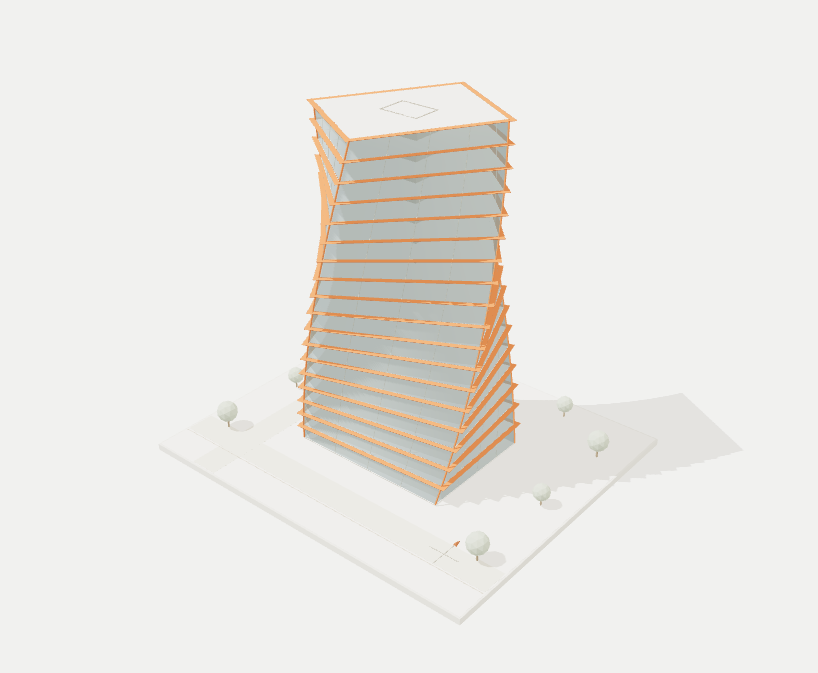

# Aether

**An architectural-computation portfolio by Saatvik Rai.**

[Open the live engine](https://saatvik-rai-aether.vercel.app) · [Read the portfolio PDF](public/Saatvik-Computation-Portfolio.pdf)

Aether connects parametric building form with explicit requirements and inspectable spatial checks. Generate alternatives, compare their consequences, and revise the assumptions in the same geometric model.



## Research question

How can explicit geometric rules and building requirements be used to generate, evaluate and revise spatial design alternatives?

## My technical background and contribution

My experience includes designing and implementing retrieval-augmented generation (RAG) pipelines, incorporating document processing, semantic chunking, embeddings and vector retrieval. I have also developed Python backend services and worked with interactive 3D building visualisation. These experiences motivated my interest in connecting information with spatial reasoning.

## The design problem

A construction requirement can lose its meaning when conditions, exceptions or cross-references are separated from it. Retrieving the relevant information alone does not establish which building elements it affects or how a proposed design change should be evaluated.

## The method

In Aether, I explore this problem through synthetic geometry, explicitly defined requirements and computational checks. Each requirement is linked to its applicable geometric target, allowing alternative spatial arrangements to be evaluated and compared. The requirements and their mappings are manually defined; automatic regulatory interpretation is not claimed.

## Explore the work

- **Generate form.** Adjust storeys, taper and twist. Shared vertices drive the 3D viewport, quantities and OBJ export.
- **Compare alternatives.** Twelve controlled tower cases compare floor area with an illustrative material carbon proxy.
- **Check occupied space.** Six service-route candidates are tested against separation, headroom and maintenance access.
- **Revise a decision.** A clearance-derived route passes at 16.20 m. Raising the beam soffit to 3.05 m allows an 11.05 m below-beam route.
- **Retain context.** An authored text fixture demonstrates how a requirement can lose its applicability condition when split.
- **Develop the research.** Proposed AI agents would connect source evidence, versioned project memory, geometric tools and designer review.

The current prototype uses authored requirements and deterministic calculations. Persistent AI agents and the research benchmarks are proposed work. The tower is concept geometry; the material proxy and service-zone checks do not establish structural, fire or statutory certification.

## Run locally

Requires Node.js 20 or later. No packages, API keys or external services are required.

```sh
git clone https://github.com/DemonJ01/aether-architectural-computation.git
cd aether-architectural-computation
npm start
```

Open the local address printed in the terminal. To run the checks:

```sh
npm test
```

## Source

```text
public/        Website, geometry engines, Three.js and portfolio PDF
api.mjs        Shared Web Request/Response API
api/index.mjs  Vercel function adapter
server.mjs     Local HTTP server
vercel.json    Hosting routes and response headers
tests/         Geometry, API and deployment checks
```

Vercel serves `public/` and routes `/api/*` to the shared API. No build or dependency installation is needed. Downloads include the PDF, tower OBJ, calculation JSON, comparison CSV and route-plan SVG.

The test suite checks analytic geometry, generated meshes, route results, input validation, exports, context retention, scene fallback and the deployment adapter.

## Credits

Project and portfolio: Saatvik Rai. AI assisted code and presentation. Three.js and OrbitControls are distributed under the [Three.js MIT licence](public/vendor/THREE-LICENSE.txt).
